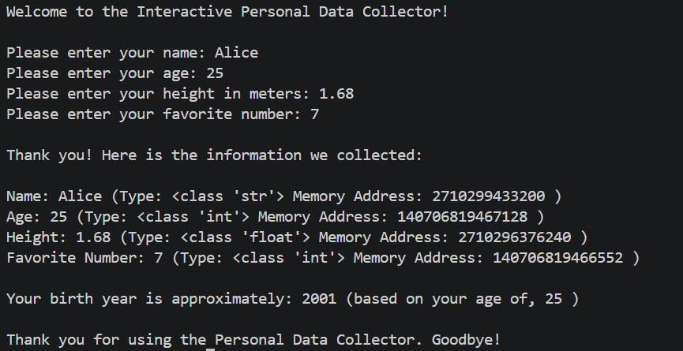

# Personal-data-collector
## Interactive Personal Data Collector 

### 📌 About the Project
The **Interactive Personal Data Collector** is a simple Python program that collects personal information from the user and displays it along with its data type and memory address.

It also calculates the user's approximate birth year based on their age.

### ✨ Features
- Collects the user's name.
- Takes the user's age.
- Collects height in meters.
- Takes the user's favorite number.
- Displays the data type of each variable.
- Displays the memory address of each variable.
- Calculates the approximate birth year.
- Shows a welcome and goodbye message.

### 💻 Example Output

